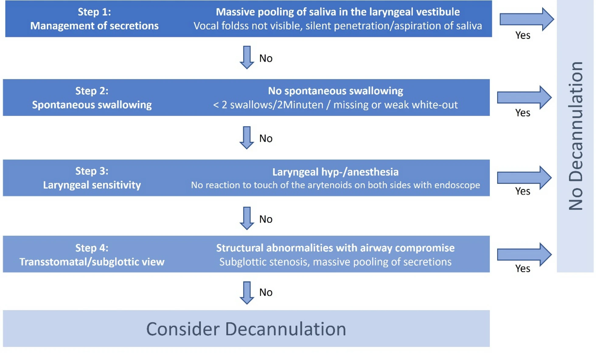
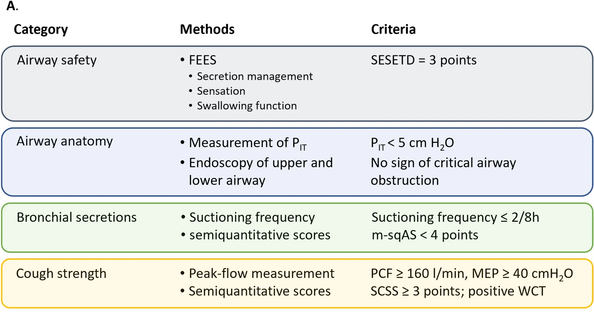
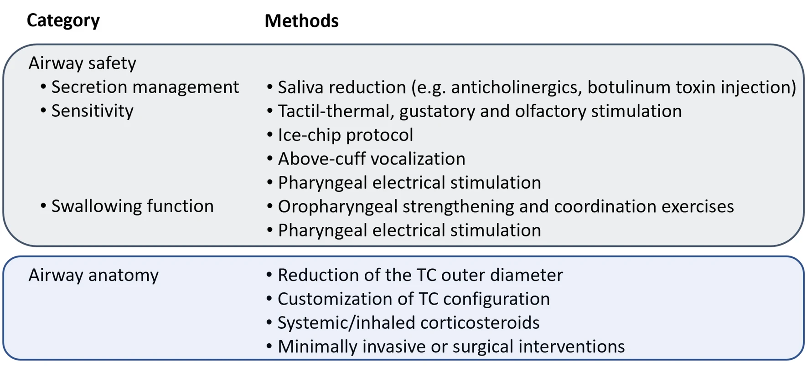
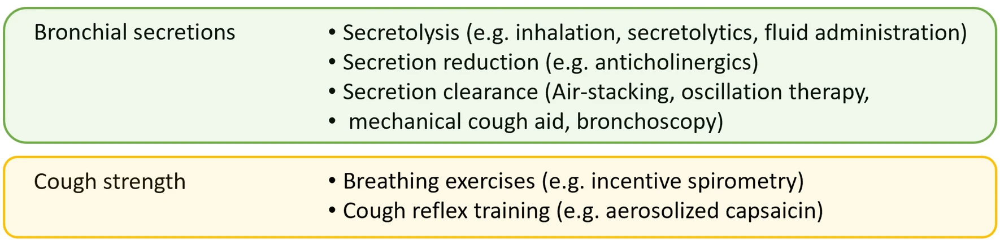

## Porque é que mantemos doentes ventilados?

| Classificação  | ICC | WIND |
|-|---|---|
| Grupo NW/0 | - | Desmame não tentado |
| Grupo 1 | "Simples": sucesso após primeiro SBT | "Curto": sucesso ou morte em < 24h |
| Grupo 2 | "Difícil": ≤ 3 SBTs + < 7 dias | "Difícil": sucesso ou morte entre 1 a 7 dias |
| Grupo 3 | "Prolongado": > 3 SBTs ou > 7 dias | "Prolongado": insucesso ou morte >7 dias *após primeira tentativa* |

: Classificações ICC e WIND de desmame ventilatório, adaptado[^table1] {.striped .hover}

[^table1]: Dolinay et al. Journal of Clinical Medicine 2024. DOI: 10.3390/jcm13071909

## Porque é que mantemos doentes ventilados?

- Dois grandes grupos de falência de Desmame:

  ::: {.incremental}
  1. **Falência Ventilatória**
  2. **Falência de Via Aérea e de estímulo ventilatório**
  :::

## Porque é que mantemos doentes ventilados?

1. **...por Falência Ventilatória**

   ::: {.incremental}
   - Grupos 2 e 3[^Ghiani]; associados a:
     - fadiga de músculos respiratórios,
     - esforço respiratório aumentado
     - patologia sistémica. [^shah]
   :::


[^shah]: Shah et al. Breathe 2024. DOI: 10.1183/20734735.0122-2024
[^Ghiani]: Ghiani et al. BMC Pulmonary Medicine 2026. DOI: 10.1186/s12890-026-04252-9

## Porque é que mantemos doentes ventilados?

2. **...por Falência de Via Aérea e de estímulo ventilatório**

   ::: {.incremental}
   - Grupo NW/0: pulmões "intactos", mas ausência de proteção de via aérea ou colaboração neurológica em SBT[^Dziewas]
   - Falência de Extubação (<48 a 72h): +++ *obstrução de VA*, tosse ineficaz, disfagia/disfunção de sensibilidade laríngea ou carga elevada de secreções[^medrinal]
     - Post-Extubation Respiratory Failure (PERF): re-intubação <7 dias[^shah]
       - Insuficiência respiratória pós-extubação
       - +++ *fadiga respiratória*, carga elevada de secreções, ou *sobrecarga hídrica ± disfunção cardíaca*
   :::

[^medrinal]: Medrinal et al. Annals of Intensive Care 2026. DOI: 10.1016/j.aicoj.2026.100045
[^Dziewas]: Dziewas et al. Neurological Research and Practice 2025. DOI: 10.1186/s42466-025-00376-1

:::{.notes}
- Falência de desmascarar défices latentes em endurance, reserva cardíaca ou carga de secreções.
:::

## Morbi-mortalidade do desmame ventilatório[^shah]^,^[^Ghiani]^,^[^Alghamdi]^,^[^medrinal]^,^[^Dziewas]

::: {.incremental}
- Prevalência:
  - Ventilação: 20 a 31% da generalidade dos doentes críticos
  - Via aérea/estímulo ventilatório: 14 a 18% na generalidade dos doentes, mas 15% a 47% dos doentes neurocríticos

- Mortalidade:
  - Falência de desmame: entre 24 a 39%, a 12 meses 40 a 75%
  - Falência de extubação associada a >2x mortalidade

- LOS (mediana): 22 a 25 dias em SMI, 45 a 51 dias no Hospital.
:::

[^shah]: Shah et al. Breathe 2024. DOI: 10.1183/20734735.0122-2024
[^Ghiani]: Ghiani et al. BMC Pulmonary Medicine 2026. DOI: 10.1186/s12890-026-04252-9
[^Alghamdi]: Alghamdi et al. The Egyptian Journal of Bronchology 2026. DOI:10.1186/s43168-026-00521-7
[^medrinal]: Medrinal et al. Annals of Intensive Care 2026. DOI: 10.1016/j.aicoj.2026.100045
[^Dziewas]: Dziewas et al. Neurological Research and Practice 2025. DOI: 10.1186/s42466-025-00376-1

::: {.notes}
- 50% dos sobreviventes permanece com dependência de assistência ventilatória
- NC: mortalidade de 50% a 12 meses com traqueostomia versus 10% restantes
- indicação *neurológica* apontada como o maior fator independente de permanência em SMI
- Cerca de 1/3 dos custos de gestão de SMI.
:::

## O problema de decisão

Traqueostomia:

**1. O doente *necessita*?**

**2. Quando?**

**3. Como?**


## Indicações[^Alghamdi]^,^[^Dziewas]

1. Ventilação mecânica (previsivelmente) prolongada (maioria)
2. Falência de Extubação (precoce + tardia)
3. Proteção de Via Aérea
      i. Disfunção Neurológica (UCIP ~15% &rarr; UCIN ~45%)
      ii. Distorção Anatómica + outras

[^Alghamdi]: Alghamdi et al. The Egyptian Journal of Bronchology 2026. DOI:10.1186/s43168-026-00521-7
[^Dziewas]: Dziewas et al. Neurological Research and Practice 2025. DOI: 10.1186/s42466-025-00376-1

## Para quê?

- Redução de espaço morto e trabalho respiratório (WOB)
  - Menos *espaço-morto*: redução em 30 a 50%[^amada]
  - Menos resistência de via aérea:
    - Maior calibre e menor comprimento
    - Menor compromisso por compressão externa[^ghattas]

[^amada]: Amada et al. British Journal of Hospital Medicine 2026. DOI: 10.31083/BJHM50155
[^ghattas]: Ghattas et al. Journal of Thoracic Disease 2021. DOI: 10.21037/jtd-19-4121

## Para quê?

- Redução de espaço morto e trabalho respiratório (WOB)

$$
\Delta P \propto \frac{L}{r^4}
$$

```{python}
#| echo: false
#| warning: false
#| fig-width: 10
#| fig-height: 3.5
#| out-width: 100%

import numpy as np
import matplotlib.pyplot as plt

# Fluxo constante: 30 L/min
Q = 30 / 60000
mu = 1.8e-5
conv = 1 / 98.0665

fig, ax = plt.subplots(1, 2, figsize=(10, 3.5))

# Gráfico 1: comprimento de 2 a 30 cm
L = np.linspace(2, 30, 200)
r = 75 / 1000  # raio fixo: 75 mm

P_L = 8 * mu * (L / 100) * Q / (np.pi * r**4) * conv

ax[0].plot(L, P_L, color="#2878B5", linewidth=2)
ax[0].set_title("Efeito do comprimento")
ax[0].set_xlabel("Comprimento (cm)")
ax[0].set_ylabel(r"$\Delta P$ (cmH$_2$O)")
ax[0].grid(alpha=0.25)

# Gráfico 2: raio de 5 a 10 cm
radius = np.linspace(5, 10, 200)
length = 0.15  # comprimento fixo: 15 cm

P_r = 8 * mu * length * Q / (np.pi * (radius / 100)**4) * conv

ax[1].plot(radius, P_r, color="#D95F02", linewidth=2)
ax[1].set_title("Efeito do raio")
ax[1].set_xlabel("Raio (cm)")
ax[1].set_ylabel(r"$\Delta P$ (cmH$_2$O)")
ax[1].grid(alpha=0.25)

# Set y-axis limits for each graph
ax[0].set_ylim(0, max(P_L) * 1.05)
ax[1].set_ylim(0, max(P_r) * 1.05)

plt.tight_layout()
plt.show()
```

:::{.notes}
- Poiseuille’s Law
- uma palhinha, um centímetro de água
:::

## Para quê?

- Redução de espaço morto e trabalho respiratório (WOB)

:::{.incremental}
- Otimização na gestão de S/A e Delirium
  - Menor reatividade ao tubo &rarr; desmame de sedo-analgesia mais precoce[^Alghamdi]
- Margem para reabilitação
  - Retorno prococe de fonação (cânula fonatória ou *cuff* desinsuflado)[^amada] e mobilização precoce[^medrinal]
  - Retorno precoce de deglutição (*cuff* e mobilidade laríngea)[^ghattas] &rarr; Efeito indireto por prevenção de delirium
- Correta *toilette* brônquica: aspirações subglóticas &rarr; mais eficazes^3
- Prevenção de trauma de CV e aritnóides &rarr; menos complicações anatómicas^1^
:::

[^Alghamdi]: Alghamdi et al. The Egyptian Journal of Bronchology 2026. DOI:10.1186/s43168-026-00521-7
[^amada]: Amada et al. British Journal of Hospital Medicine 2026. DOI: 10.31083/BJHM50155
[^medrinal]: Medrinal et al. Annals of Intensive Care 2026. DOI: 10.1016/j.aicoj.2026.100045
[^ghattas]: Ghattas et al. Journal of Thoracic Disease 2021. DOI: 10.21037/jtd-19-4121

## Para quê? E quando? &rarr; *TracMan Trial*[^tracman]

:::{.incremental}
- JAMA 2013
- Reino Unido, 2004 a 2011
- 70 UCIP + 2 UCI Cirurgia Cardíaca
- 1032 doentes elegíveis &rarr; 889 analisados:
  - <4 dias de VMI à data de seleção
  - clinicamente com potencial de necessitar de >7 dias de VMI
- Dois grupos randomizados: traqueostomias ≤4 dias *versus* >10 dias
:::

[^tracman]: Young et al. The TracMan Randomized Trial. JAMA 2013. DOI:10.1001/jama.2013.5154

## Para quê? E quando? &rarr; *TracMan Trial*[^tracman]

- 2004 a 2011, 889 analisados
- Traqueostomias ≤4 dias *versus* >10 dias

:::{.incremental}
- Resultados:
  - Mortalidade a 30 dias: ~31% em ambos, p>0.5
    - Sem diferenças à alta de SMI, hospitalar, 12 e 24 meses
  - LOS: semelhante.
  - Dias livres de antibiótico: semelhante.
  - **Duração de sedação (mediana): 5 *versus* 8 dias**, p<0.001
:::

[^tracman]: Young et al. The TracMan Randomized Trial. JAMA 2013. DOI:10.1001/jama.2013.5154

## Para quê? E quando?

*TracMan Trial*[^tracman]: o único RCT, resultados debatíveis

:::{.incremental}
   - Exclusão explícita de doentes neurocríticos
     - *because our study centers indicated these patients [usually receive early tracheostomies]{.mark}*
   - 53.7% (244/454) do grupo tardio **nunca** foi traqueostomizado
     - 167 recuperaram espontaneamente &rarr; extubados &rarr; alta
   - Análise de dias de antibiótico, sem análise de pneumonias associada a intubação (PAI)
:::

[^tracman]: Young et al. The TracMan Randomized Trial. JAMA 2013. DOI:10.1001/jama.2013.5154

:::{.notes}
- Para um estudo que pretende saber se fazer mais precoce ou esperar um pouco mais tem benefício, parece uma grande oportunidade perdida, especialmente atendendo que...
- Estrutura em "intend to treat"
- Prova da sobre-estimativa em particular no doente não neurocrítico
:::

## Para quê? E quando? Nova Evidência.

Quais são as conclusões? Quais são as orientações?

:::{.incremental}
1. Traqueostomias precoces previnem PAI?
    - Boni et al. (2025): *Umbrella review* + nova meta-análise + análise sequencial (19 RCT, 3421 pacientes)[^boni]
    - **Precoce previne PAI** (OR 0.65, 95% CI 0.47–0.89, p = 0.007) mas sem benefício claro na mortalidade. (OR 0.85, 95% CI 0.70–1.03, p = 0.09)
    - Não há consenso na definição de precoce ou tardia &rarr; 7 dias (RCT) *vs* 10 dias (RS)
      - Mas alterar ponto de corte não afetou significativamente resultados (4 *vs* 7 *vs* 10)
      - 400k pacientes seriam necessários para confirmar impacto terapêutico real
    - Fraca qualidade de evidência principalmente por critérios de diagnóstico muito variáveis
:::

:::{.notes}
- Meta-regression in Boni et al. (2025) confirmed that neither neurological admission condition ($p = 0.372$) nor specific timing definition choice ($p = 0.33$) moderated patient survival2.
:::

[^boni]: Boni et al. BMJ Open Respir Res 2025. DOI: 10.1136/bmjresp-2024-002434

## Para quê? E quando? Nova Evidência.

Quais são as conclusões? Quais são as orientações?

1. Não usar só por potencial protetor de PAI ou para reduzir tempo de VMI; **<4 dias sem redução de mortalidade evidente.** (Guidelines Francesas[^troi]^,^[^medrinal])

:::{.incremental}
2. Traqueostomias facilitam desmame ventilatório?
    - Ghiani et al. (2026): coorte retrospetiva, 12 anos &rarr; 440 doentes sob VMI[^Ghiani]
    - Precoce definida como <14 dias, *confirmado com <10 dias*
    - Sem diferenças em % de VMI prolongada, falência de descanulação ou mortalidade
      - Até em mecânica ventilatória e reserva funcional
    - Diferença: **tempo total de VMI (40 vs 51 dias)**
      - *mas...* causado por atrasos em transferência para a Unidade
:::

:::{.notes}
- unicentrico
- Ponderado para fatores individuais dos doentes
:::

[^troi]: Troillet et al. Annals of Intensive Care 2018. DOI:10.1186/s13613-018-0381-y
[^medrinal]: Medrinal et al. Annals of Intensive Care 2026. DOI: 10.1016/j.aicoj.2026.100045
[^Ghiani]: Ghiani et sal. BMC Pulmonary Medicine 2026. DOI: 10.1186/s12890-026-04252-9

## Para quê? E quando? Nova Evidência.

Quais são as conclusões? Quais são as orientações?

1. Não usar só por potencial protetor de PAI ou para reduzir tempo de VMI; **<4 dias sem redução de mortalidade evidente.**

2. **Medidas de desmame controlado sempre**, independentemente do momento da intervenção. (Guidelines Francesas[^troi]^,^[^medrinal])

:::{.incremental}
3. Quando então?
    - TracMan[^tracman] chamou a atenção do viés clínico
    - Boni et al [^boni] não viu diferenças impacto de patologia neurológica ou outros diagnósticos em benefícios de mortalidade
:::

[^troi]: Troillet et al. Annals of Intensive Care 2018. DOI:10.1186/s13613-018-0381-y
[^medrinal]: Medrinal et al. Annals of Intensive Care 2026. DOI: 10.1016/j.aicoj.2026.100045
[^tracman]: Young et al. The TracMan Randomized Trial. JAMA 2013. DOI:10.1001/jama.2013.5154
[^boni]: Boni et al. BMJ Open Respir Res 2025. DOI: 10.1136/bmjresp-2024-002434

## Para quê? E quando? Nova Evidência.

Quais são as conclusões? Quais são as orientações?

1. Não usar só por potencial protetor de PAI ou para reduzir tempo de VMI; **<4 dias sem redução de mortalidade evidente.**

2. **Medidas de desmame controlado sempre**, independentemente do momento da intervenção. (Guidelines Francesas[^troi]^,^[^medrinal])

3. Quando então?

:::{.incremental}
- Indicações de peritos assentam em:
  - **Nunca antes dos 4 dias**
  - **Pensar em todos os doentes do Grupo 3 de desmame ventilatório**
  - *Mais precoce* se **patologia neuromuscular adquirida reversível** (e.g. Guillain-Barré)
:::

[^troi]: Troillet et al. Annals of Intensive Care 2018. DOI:10.1186/s13613-018-0381-y
[^medrinal]: Medrinal et al. Annals of Intensive Care 2026. DOI: 10.1016/j.aicoj.2026.100045

## Como?

:::{.incremental}
- Opção 1: Percutânea
- Opção 2: Cirúrgica
- Opção 3: Híbrida
:::

## Como?

:::{.incremental}
- Opção 1: Percutânea[^troi]^,^[^locatello]^,^[^Alghamdi]^,^[^ghattas]
  - Minimamente invasiva, técnica de Seldinger ± Broncoscópio; ± Ecógrafo
  - Vantagens:
    - Menos risco associado a transporte
    - Taxas de infeção mais baixas (menor invasividade)
    - Associada a menor LOS em UCI (22 vs 25 dias) e hospitalar (45 vs 47 dias)
  - Limitações/Contraindicações:
    - Dificuldade na palpação de anéis traqueais; Obesidade
    - Imobilização cervical
    - Massas cervicais; Coagulopatia (sem controlo)
:::

[^locatello]: Locatello et al. The Laryngoscope 2026. DOI: 10.1002/lary.70702

## Como?

- Opção 1: Percutânea

:::{.incremental}
- Opção 2: Cirúrgica [^locatello]^,^[^Alghamdi]^,^[^winchester]
  - Disseção cirúrgica em bloco operatório, tipicamente por ORL
  - Vantagens:
    - Alterações Anatómicas
    - Dificuldade técnica de realização de traqueostomia percutânea
    - Elevado risco de procedimento
  - Limitações/Contraindicações:
    - Transporte de elevado risco
    - Custos elevados de procedimento
    - Atrasos de agendamento
:::

[^winchester]: Winchester et al. Head & Neck 2025. DOI: 10.1002/hed.27948

## Como?

- Opção 1: Percutânea
- Opção 2: Cirúrgica

:::{.incremental}
- Opção 3: Híbrida[^locatello]^,^[^winchester]
  - Abordagem cirúrgica, **na unidade**, por cirurgião e gestão anestésica pelo SMI
  - Vantagens logísticas da técnica percutânea sem as limitações associadas
    - Redução de atrasos de agendamento (84 vs 55 horas para primeira avaliação)
    - Sem aumentar taxa de complicações cirúrgicas
    - Redução de custos relatado entre 54 a 73%
    - Menor tempo de procedimento (28.9 min vs 36.9 min)
:::


## O problema de decisão

Traqueostomia:

:::{.incremental}
1. O doente *necessita*?
2. Quando?
3. Como?
4. Quando e como **parar**?
:::

## Desmame e descanulação

:::{.incremental}
- Duas grandes **referências da literatura**:
  - Orientações Francesas de 2026[^medrinal]
  - *Framework* de Descanulação Neurológica de 2025[^Dziewas]
- Três grandes linhas de pensamento:
  1. **Desmame ventilatório**
  2. **Otimização da via aérea**
  3. **Descanulação**
:::

## 1. Desmame Ventilatório no traqueostomizado

:::{.incremental}
- Privilegiar **desmame mais agressivo (peça em T ou nariz artificial)** versus pressão de suporte)
  - 500 adultos ventilados >21 dias
    - *31% tolerou 5 dias sem assistência* &rarr; excluídos
    - Restantes estratificados: falência precoce (<12h) ou tardia.
    - Dois grupos:
      - D1-2 *12h on 12h off* &rarr; D3 a +5 *24h off*
      - PS desmame q8h 2cmH~2~O até 6cmH~2~O
    - **Desmame mais curto** (15 vs 19 dias) sem impacto na mortalidade
      - Diferenças só no grupo tardio
:::

:::{.notes}
- substimamos capacidade de desmame ventilatório
:::

## 2. Otimização de Via Aérea

:::{.incremental}
- Acompanhar desmame ventilatório com **cuff desinsuflado + válvula fonatória**
  - Cuff vazio &rarr; restabelece pressão subglótica e elevação laríngea &rarr; reduz micro-  aspirações em cerca de 15%
  - Válvula fonatória &rarr; direciona fluxo de ar &rarr; reduz aspiração em 50%
  - 181 doentes traqueostomizados
    - Patência supraglótica confirmada com oclusão da traqueostomia
    - **Menos tempo até desmame** (3 dias vs 8 dias) e **menor taxa de infeções respiratórias** (20% vs 36%)
    - Limitações:
      - Excluídos doentes neurológicos e com disfagia severa
      - Ar humificado a 69L/min no grupo de intervenção versus 55L/min no controlo
:::

## 2. Otimização de Via Aérea

- Acompanhar desmame ventilatório com **cuff desinsuflado + válvula fonatória**

:::{.incremental}
- Troca de cânula programada **não está recomendada**
- Considerar troca de cânula no contexto de downsizing para otimizar desmame ventilatório
  - Três grandes estudos: Heliyon  2024, Manometry 2009, Wahla 2020
    - Cânula interna aumenta resistência da via aérea em 2 a 3 vezes
    - Trocas rotineiras <6 dias aumentam complicações sem benefício
    - Comparação calendário vs troca individualizada
      - *Redução de um tamanho se doente falhar obturação da cânula/válvula fonatória* (&uarr; trabalho respiratório ou P~IT~ > 10cmH~2~O)
        - Melhor tolerância a trials (78% vs 95%)
        - **Preditor independente de sucesso de descanulação**
:::

:::{.notes}
taxas de lesão de estoma, falsos trajetos e complicações pulmonares sem reduzir biofilme bacteriano
:::

## 3. Descanulação

:::{.incremental}
- Quando considerar?
  - Após desmame ventilatório, se sem desfagia major, **guiar pela frequência de aspirações** vs por testes de obturação 24h
    - Espaço morto supra-estoma &rarr; *30% do trabalho respiratório* &rarr; *falência de desmame*
    - 330 pacientes, multicêntrico
      - Seleção: cuff desinsuflado, teste de 5 minutos sem estridor + teste de deglutição com 50cc de água
      - Todos: alto fluxo + cânula aberta e cuff vazio; se ≤2 aspirações q8h em 24h:
        a. Descanular imediatamente
        b. Obturação 24h e vigiar dificuldade respiratória
      - Grupo A: **menos tempo de desmame** (6 vs 13 dias), **menos infeções respiratórias**, **menos recanulações** (2.4% vs 5.6%), e **menor estadia hospitalar** (48 vs 62 dias)
:::

## 3. Descanulação

:::{.incremental}
- Como orientar?
  - Abordagem multidisciplinar
  - Ainda sem benefício claro *verificação endoscópica* em todos &rarr; testes clínicos parecem suficientes
    - Reservar para:
      - Intolerância à obturação
      - Alterações inesperadas durante desmame
      - Doentes neurocríticos
:::

## 3. Descanulação

- Como orientar?
    

## 3. Descanulação

- Como orientar?
  - Abordagem multidisciplinar
  - Ainda sem benefício claro *verificação endoscópica* em todos &rarr; testes clínicos parecem suficientes
    - Protocolo SESETD
  - Bundles de intervenção parecem ser eficazes &rarr; algoritmo sugerido por Dziewas et al[^Dziewas]
    - **A^2^BC Pathway**

## 3. Descanulação

- Como orientar?
  - **A^2^BC Pathway** &rarr; Diagnóstico:
  

## 3. Descanulação

- Como orientar?
  - **A^2^BC Pathway** &rarr; Abordagem:
    

## 3. Descanulação

- Como orientar?
  - **A^2^BC Pathway** &rarr; Abordagem:
    

## Mensagens para levar para casa

:::{.incremental}
1. **Indicação:** a traqueostomia serve o desmame de doentes do Grupo 3 (VM prolongada), a falência de extubação e a proteção de via aérea. Reduz espaço morto e resistência, e abre margem para reabilitação.

2. **Timing:** nunca antes dos 4 dias. Não usar só para prevenir PAI ou encurtar a VMI. Antecipar na patologia neuromuscular reversível (e.g. Guillain-Barré).

4. **Técnica:** a percutânea continua a ser a primeira linha. A híbrida surge na otimização da abordagem cirúrgica &rarr; feita na unidade reduz atrasos e custos.

5. **Desmame:** Privilegiar a peça em T ou o nariz artificial em vez da pressão de suporte.

6. **Via aérea:** ser agressivo no desmame parece paradoxal mas permite rapidez na proteção independente de via aérea.

7. **Descanulação:** guiar pela frequência de aspirações. Seguir protocolos &uarr; Qualidade e Reprodutibilidade
:::
